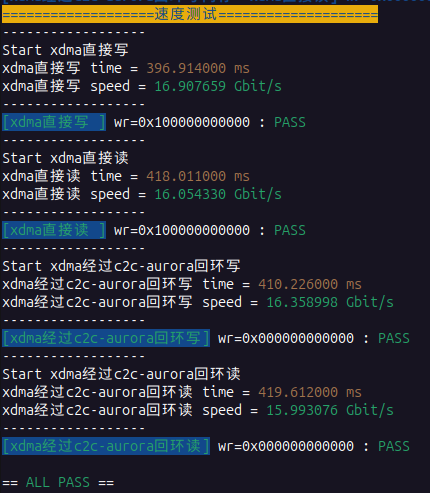
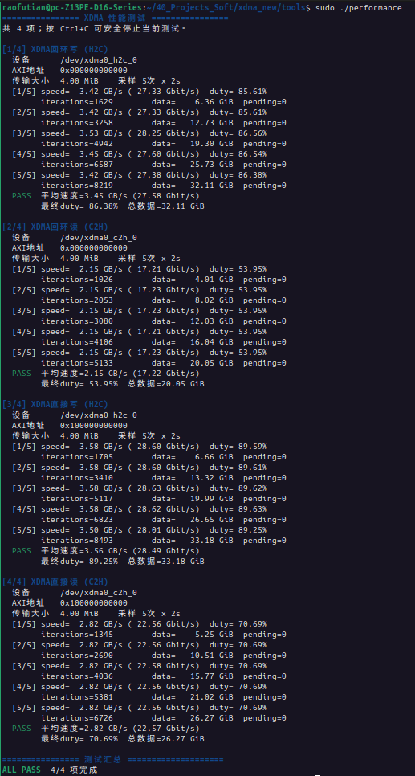
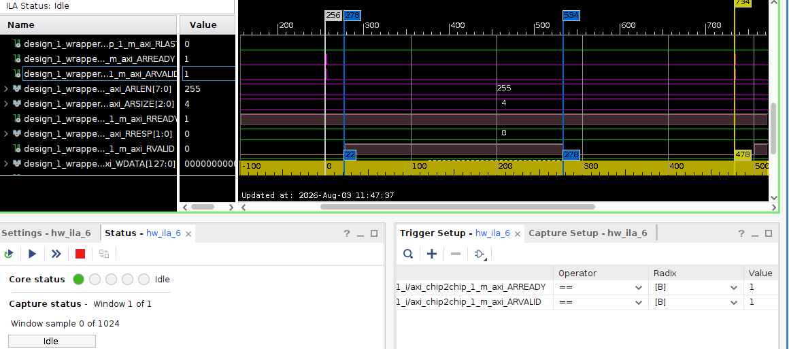
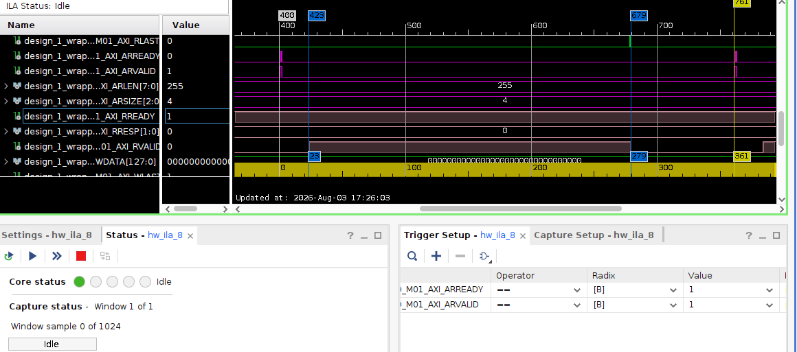
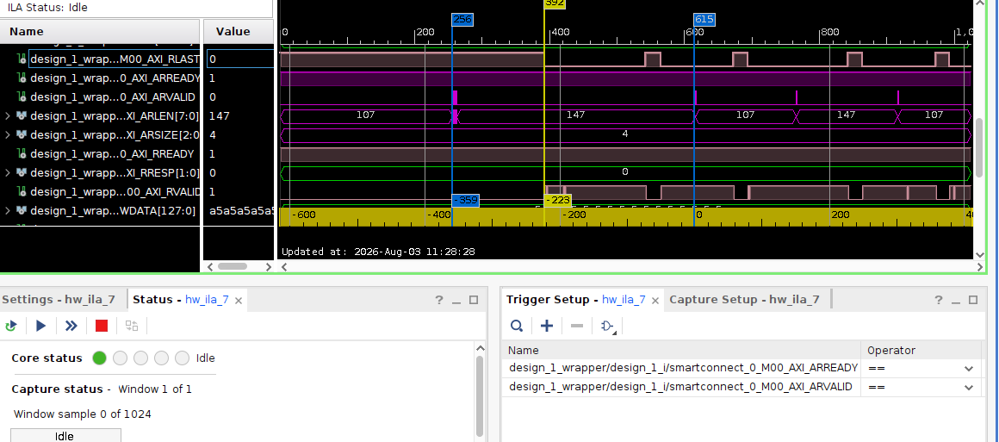
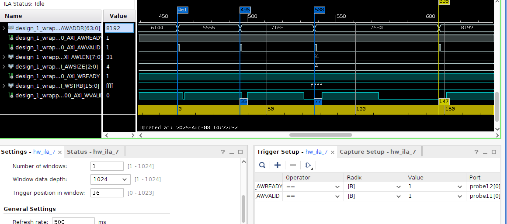
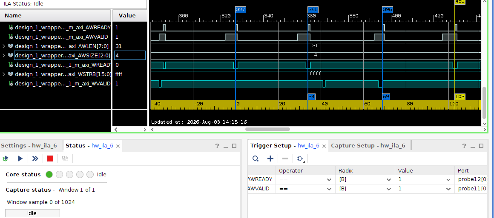
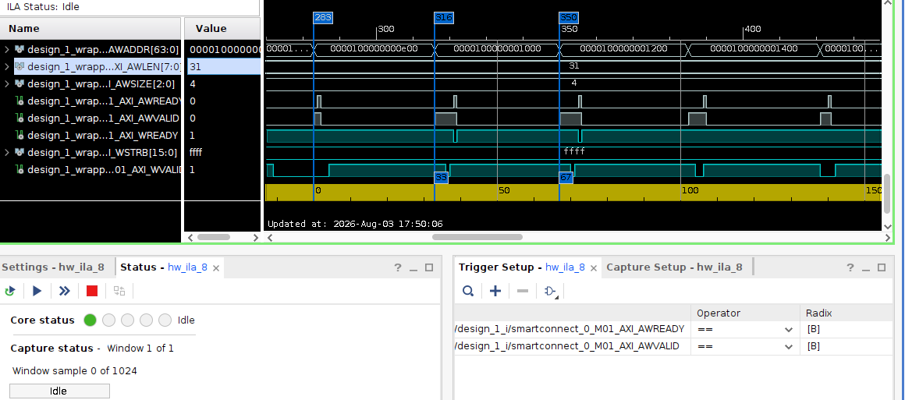
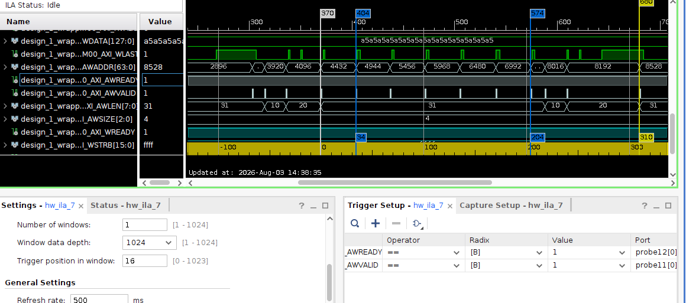
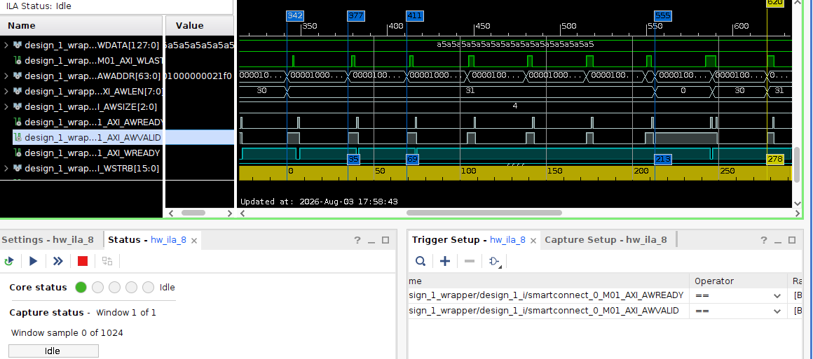

# XDMA、C2C/Aurora 通路吞吐率测试报告

## 3 lane 与 1 lane 测速对比汇总

| 通路 | 工具 | 方向 | 3 lane 平均速率 | 1 lane 平均速率 | 速率变化 | 3 lane 归一化效率 | 1 lane 归一化效率 |
|---|---|---|---:|---:|---:|---:|---:|
| C2C/Aurora 回环 | `performance` | C2H/读 | 17.22 Gbit/s | 待测 | 待计算 | 53.81% | 待计算 |
| C2C/Aurora 回环 | `performance` | H2C/写 | 27.58 Gbit/s | 待测 | 待计算 | 86.19% | 待计算 |
| C2C/Aurora 回环 | `mb/main` | C2H/读 | 15.993076 Gbit/s | 待测 | 待计算 | 49.98% | 待计算 |
| C2C/Aurora 回环 | `mb/main` | H2C/写 | 16.358998 Gbit/s | 待测 | 待计算 | 51.12% | 待计算 |
| 直连 BRAM | `performance` | C2H/读 | 22.57 Gbit/s | 待测 | 待计算 | 70.53% | 待计算 |
| 直连 BRAM | `performance` | H2C/写 | 28.49 Gbit/s | 待测 | 待计算 | 89.03% | 待计算 |
| 直连 BRAM | `mb/main` | C2H/读 | 16.054330 Gbit/s | 待测 | 待计算 | 50.17% | 待计算 |
| 直连 BRAM | `mb/main` | H2C/写 | 16.907659 Gbit/s | 待测 | 待计算 | 52.84% | 待计算 |

> 1 lane 数据待测。完成测试后，在同一行填入结果并计算速率变化和归一化效率。

## 1. 测试结论

本次在 U280 上分别使用 `tools/performance` 和 `mb/main` 测试 XDMA 的回环通路与直连 BRAM 通路。核心结论如下：

1. **回环读是当前硬件通路的主要瓶颈。** `performance` 实测平均速率为 `17.22 Gbit/s`。ILA 中 `RREADY` 长时间为高、`RVALID` 间断，说明接收端可以持续接收，但返回数据不连续。瓶颈主要来自 BRAM 读延迟、SmartConnect/C2C/Aurora 的事务往返延迟，以及读请求并发度不足。
2. **回环写的硬件通路表现较好。** `performance` 实测平均速率为 `27.58 Gbit/s`，写数据基本以 32 beat burst 流水传输，C2C/Aurora 对写通路的额外影响较小。
3. **用户态同步 `read()`/`write()` 存在明显的软件开销。** `mb/main` 回环写与回环读分别为 `16.358998 Gbit/s` 和 `15.993076 Gbit/s`，四项实测结果分布在 `15.99～16.91 Gbit/s`。每次调用都需要固定用户页、建立 DMA/SG 映射、构造描述符、等待完成并释放映射，不能与 `performance` 的内核态循环描述符口径直接等同。
4. **Aurora 的 `3 x 25 Gbit/s = 75 Gbit/s` 是物理层聚合线速，不是本工程的端到端有效载荷上限。** 当前 XDMA AXI 数据宽度为 128 bit、时钟约为 250 MHz，AXI 理论带宽为 `32 Gbit/s`。因此，后文使用 `32 Gbit/s` 作为数据周期利用率的对比基准。

## 2. 测试环境与方法

### 2.1 硬件环境

| 项目 | 配置 |
|---|---|
| FPGA 板卡 | Xilinx Alveo U280 |
| 测试主机 | 185 服务器 |
| 测试存储空间 | 4 MiB BRAM |
| BRAM 读延迟 | 设置值 20 clk，ILA 观测约 22 clk |
| PCIe/XDMA | PCIe Gen3 x4，AXI 128 bit @ 约 250 MHz |
| Aurora | 3 lane x 25 Gbit/s，聚合线速 75 Gbit/s |
| AXI Chip2Chip | Compact 比例 1:1 |

### 2.2 测试工具

| 工具 | 调用方式 | 测量含义 |
|---|---|---|
| `/home/raofutian/40_Projects_Soft/xdma_new/tools/performance` | 通过 `ioctl` 启动内核态循环 DMA 描述符 | 基本排除重复系统调用和用户态调度间隔，用于观察硬件通路上限 |
| `/home/raofutian/40_Projects_Soft/xdma_new/mb/main` | 用户态同步 `read()`/`write()` | 包含用户页 pin/map、SG 和描述符初始化、中断等待等开销，表示应用层端到端性能 |

两个工具均使用 4 MiB 单次传输。`performance` 每项连续采样 5 次，每次 2 s；`mb/main` 对每条路径重复调用 200 次。

### 2.3 数据通路

- **回环通路（Loop）**：`PCIe -> XDMA -> SmartConnect -> C2C -> Aurora -> Aurora -> C2C -> 远端 BRAM`
- **直连通路（Direct）**：`PCIe -> XDMA -> SmartConnect -> 本地 BRAM`
- **H2C/写**：Host to Card，主机向 FPGA 写数据。
- **C2H/读**：Card to Host，主机从 FPGA 读数据。

## 3. 原始测速结果

### 3.1 测速截图

**图 1　`mb/main` 3 lane 用户态测速结果**



**图 2　`performance` 3 lane 内核态循环 DMA 测速结果**



### 3.2 结果对比

从两种测试口径的差值可以看出：

- 用户态回环读达到硬件基准的 `92.88%`，说明读通路的首要问题仍在硬件返回数据不连续。
- 用户态回环写仅达到硬件基准的 `59.31%`，说明用户页映射、描述符构造和同步等待对写吞吐率影响明显。
- `performance` 直连读为 `22.57 Gbit/s`，回环读为 `17.22 Gbit/s`，说明 C2C/Aurora 往返使读吞吐率进一步下降了 `23.70%`。

## 4. 读通路分析

### 4.1 `performance` 回环读

在 SmartConnect 输出端观测到，每个读 burst 传输 256 beat，两组数据起点间隔约为 475 clk：

```text
有效数据周期利用率 = 256 / 475 = 53.89%
```

该结果与 `performance` 报告的 `53.95%` duty 以及 `17.22 / 32 = 53.81%` 带宽利用率基本一致。`RREADY` 长时间为 1，但 `RVALID` 在 burst 之间存在大段空闲，因此不是主机或 XDMA 接收端施加背压，而是从机返回数据不足。

**图 3　`performance` 回环读：SmartConnect 输出端（连接 C2C）**


在 C2C 输出到 BRAM 的一侧，读请求接收后约 22 clk 开始返回 256 beat 连续数据，之后仍需等待约 200 clk 才出现下一次响应。这说明 BRAM 本身的读延迟只是总空洞的一小部分，更多时间消耗在读事务经过 SmartConnect、C2C 和 Aurora 的往返以及下一笔请求的调度上。

**图 4　`performance` 回环读：C2C 输出端（连接远端 BRAM）**



### 4.2 `performance` 直连 BRAM 读

直连 BRAM 时，256 beat 有效数据的整体周期约为 361 clk：

```text
有效数据周期利用率 = 256 / 361 = 70.91%
```

直连路径比回环路径少约 `114 clk`，说明 C2C/Aurora 往返延迟确实扩大了读通路的空洞。但直连 BRAM 仍有约 105 clk 非数据周期，因此不能把全部损耗都归因于 Aurora，SmartConnect、BRAM 读延迟和读请求调度同样需要考虑。

**图 5　`performance` 直连读：SmartConnect 直连本地 BRAM 接口**



### 4.3 `mb/main` 用户态读

用户态测试中同样表现为 `RREADY` 多、`RVALID` 少。ILA 还可见 `ARLEN=107` 和 `ARLEN=147` 等被分割的读请求，对应的 108 beat 与 148 beat 合计为 256 beat。这与用户缓冲区在 4 KiB 页边界被 SG 分段的特征一致，会增加请求数量和调度间隔。

**图 6　`mb/main` 回环读：SmartConnect 输出端（连接 C2C）**



## 5. 写通路分析

### 5.1 `performance` 回环写

在 SmartConnect 输出端，写请求以 `AWLEN=31` 传输，即每个 burst 包含 32 beat（512 Byte）。数据整体呈流水传输，只在跨页或描述符调度时出现额外间隔。

**图 7　`performance` 回环写：SmartConnect 输出端（连接 C2C）**



在 C2C 输出到 BRAM 的一侧，相邻 32 beat burst 的起点间隔通常为 34～35 clk，即除 32 个数据周期外仅有约 2～3 clk 握手或调度开销。这与 `27.58 Gbit/s` 的高写带宽一致。

**图 8　`performance` 回环写：C2C 输出端（连接远端 BRAM）**



直连 BRAM 的写时序与回环通路接近，进一步说明 C2C/Aurora 目前不是写通路的主要瓶颈。

**图 9　`performance` 直连写：SmartConnect 直连本地 BRAM 接口**



### 5.2 `mb/main` 用户态写

用户态回环写在普通位置仍以 32 beat burst 传输，但每到 4 KiB 页边界都会出现额外的 SG/描述符调度开销。完成 4 KiB 数据需要约 310 clk，其中有效数据为 256 beat：

```text
回环写数据周期利用率 = 256 / 310 = 82.58%
```

**图 10　`mb/main` 回环写：C2C 输出端（连接远端 BRAM）**



用户态直连 BRAM 写完成 4 KiB 数据约需 278 clk：

```text
直连写数据周期利用率 = 256 / 278 = 92.09%
```

回环写相比直连写多约 32 clk/4 KiB，这部分可归因于 C2C/Aurora 通路带来的额外事务开销；但两者均存在 4 KiB 边界间隔，说明用户态 DMA 映射和调度仍是更普遍的影响因素。

**图 11　`mb/main` 直连写：SmartConnect 直连本地 BRAM 接口**



## 6. 瓶颈定位

| 层级 | 观测证据 | 判断 |
|---|---|---|
| 回环读硬件通路 | `RREADY=1` 时 `RVALID` 长时间无效；256 beat 需约 475 clk | 返回数据供给不连续，往返延迟没有被足够的在途读请求隐藏 |
| 直连读硬件通路 | 256 beat 需约 361 clk | SmartConnect、BRAM 延迟和读调度本身已产生较大空洞 |
| 回环写硬件通路 | 32 beat burst 间仅约 2～3 clk 开销，带宽为 27.58 Gbit/s | 写通路基本流水化，C2C/Aurora 不是主瓶颈 |
| 用户态 DMA | 回环写带宽从 27.58 Gbit/s 降至 16.358998 Gbit/s，且 4 KiB 边界有明显间隔 | 重复页固定、DMA/SG 映射、描述符构造和同步等待开销明显 |

## 7. 优化建议

### 7.1 优先优化读 outstanding

当前即使 `ARLEN=255`（单个 burst 已达 256 beat），读数据周期利用率仍只有约 54%，因此继续增大单个 burst 无法解决问题。建议在 ILA 中统计：

```text
AR 接收事件 = ARVALID && ARREADY
读完成事件 = RVALID && RREADY && RLAST
outstanding = AR 接收累计数 - 读完成累计数
```

若 `outstanding_max <= 1`，说明读请求被串行化。应优先检查 XDMA、SmartConnect 和 C2C 的 read acceptance/issuing、ID 宽度以及 read outstanding 配置，使多笔读请求同时在途，用并发覆盖 C2C/Aurora 的往返延迟。

### 7.2 减少用户态每次 DMA 的初始化开销

参考 `tools/performance.c` 的 `ioctl` 模型，可以按以下顺序优化：

1. 在驱动中增加 registered buffer 机制，使用户缓冲区只 pin/map 一次，后续反复提交。
2. 支持异步多请求队列，让下一笔 DMA 的准备与当前传输重叠。
3. 在端点地址范围允许时，增大单次传输量，以摊薄固定的映射、描述符和中断开销。
4. 将 `lseek()+read()/write()` 替换为 `pread()/pwrite()`，减少一次系统调用并避免文件偏移状态带来的干扰。

### 7.3 完善下一轮测试记录

下一轮建议对 direct/loop、H2C/C2H 四种组合同时记录：平均速率、data duty cycle、`outstanding_max`、`AR/AW` burst 分布、单次传输大小、用户缓冲区页内偏移和 SG 段数。这样可以将物理链路、AXI 事务调度和用户态 DMA 开销分开量化。

## 8. 3 lane 与 1 lane 对比测试方法与判据

### 8.1 对比基准

1 lane 配置的 GT 线速为 `25 Gbit/s`。考虑 Aurora 64B/66B 编码后，不含更高层控制字和帧间隔的理论有效载荷上限为：

```text
1 lane Aurora 编码后上限 = 25 x 64 / 66 = 24.24 Gbit/s
3 lane Aurora 编码后上限 = 75 x 64 / 66 = 72.73 Gbit/s
```

因此，两种配置的回环通路应使用不同的归一化基准：

| GT 配置 | Aurora 编码后上限 | AXI 上限 | 回环通路归一化基准 |
|---|---:|---:|---:|
| 3 lane x 25 Gbit/s | 72.73 Gbit/s | 32.00 Gbit/s | 32.00 Gbit/s |
| 1 lane x 25 Gbit/s | 24.24 Gbit/s | 32.00 Gbit/s | 24.24 Gbit/s |

> 24.24 Gbit/s 只是扣除 64B/66B 编码后的理论上限，实际吞吐率还会受 Aurora 控制字、C2C 打包、流控和 AXI 事务空洞影响。直连 BRAM 通路不经过 Aurora，两种配置均使用 32 Gbit/s AXI 上限作为归一化基准。

### 8.2 对比指标计算方法

文档顶部对比汇总表的计算公式为：

```text
速率变化 = (1 lane 速率 - 3 lane 速率) / 3 lane 速率 x 100%
3 lane 回环归一化效率 = 3 lane 实测速率 / 32.00 x 100%
1 lane 回环归一化效率 = 1 lane 实测速率 / 24.24 x 100%
直连 BRAM 归一化效率 = 实测速率 / 32.00 x 100%
```

### 8.3 ILA 时序对比表

| 观测项 | 3 lane 当前值 | 1 lane 实测值 | 需要关注的变化 |
|---|---:|---:|---|
| `performance` 回环读：256 beat 起点间隔 | 约 475 clk | 待测 | 间隔是否因单 lane 串行化而增大 |
| `performance` 回环读：数据周期利用率 | 53.89% | 待计算 | `RVALID` 空洞是否增大 |
| `performance` 直连读：256 beat 起点间隔 | 约 361 clk | 待复测 | 理论上应与 lane 数无关，用于判断测试波动 |
| `performance` 回环写：32 beat burst 起点间隔 | 约 34～35 clk | 待测 | 是否出现更多 `WVALID` 空洞或 `WREADY` 背压 |
| `mb/main` 回环写：4 KiB 总周期 | 约 310 clk | 待测 | C2C/Aurora 开销与用户态页边界开销的变化 |
| `mb/main` 直连写：4 KiB 总周期 | 约 278 clk | 待复测 | 理论上应与 lane 数无关 |
| 回环读 `outstanding_max` | 需补测 | 待测 | 确认读请求是否仍被串行化 |

### 8.4 测试条件控制

两轮测试除 GT lane 数外，应保持以下条件一致：

- 同一台 185 服务器、同一个 PCIe 槽位和相同的 PCIe Gen3 x4 链路状态。
- 相同的 XDMA 驱动、工具版本、CPU/NUMA 绑定与系统负载。
- 相同的 4 MiB 单次传输、重复次数、采样时间和 AXI endpoint 地址。
- 相同的 AXI 时钟、数据宽度、C2C Compact 比例、BRAM 容量和 BRAM 读延迟。
- 先复测直连 BRAM，再测回环通路。若两轮的直连速率差异超过 3%，应先排查主机环境、PCIe 链路或测试波动，不直接将回环差异归因于 GT lane 数。

### 8.5 结果判读

| 1 lane 实测现象 | 可得出的结论 |
|---|---|
| 直连吞吐率基本不变，回环写降至约 24 Gbit/s 或更低 | 1 lane Aurora 已成为回环写的带宽上限 |
| 回环读仍约为 17.22 Gbit/s | 读 outstanding/返回空洞仍是主瓶颈，1 lane 带宽尚未被用满 |
| 回环读和写都按 lane 数大幅下降 | Aurora/C2C 串行化对两个方向都产生了主导影响 |
| 1 lane 绝对速率下降，但归一化效率上升 | 单 lane 配置的有效带宽更低，但通路利用更充分 |
| 直连吞吐率也显著变化 | 不能只归因于 GT lane，需先排查 PCIe、时钟、驱动或主机测试环境 |
